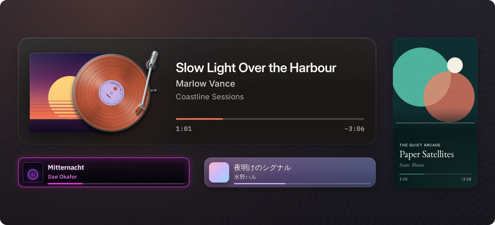
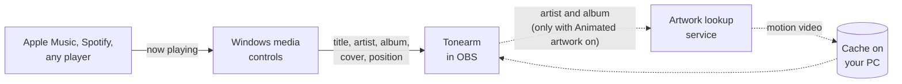
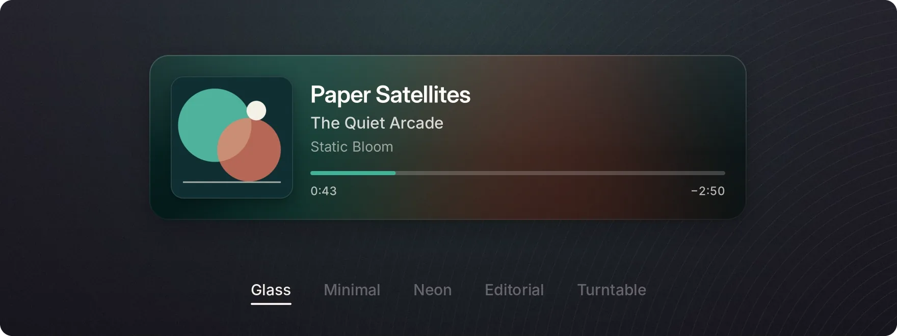
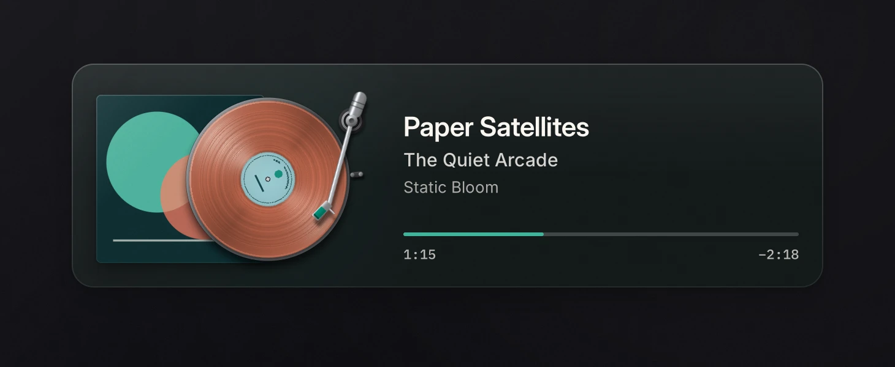
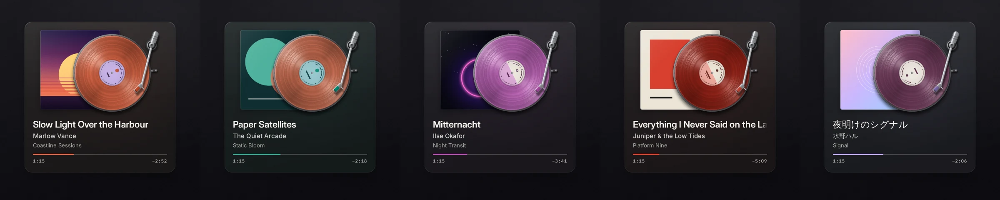
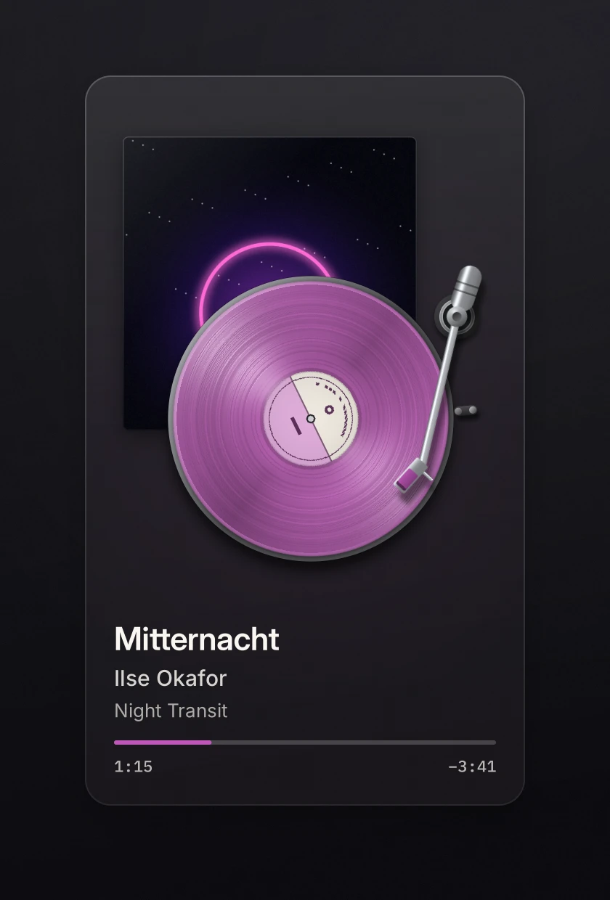
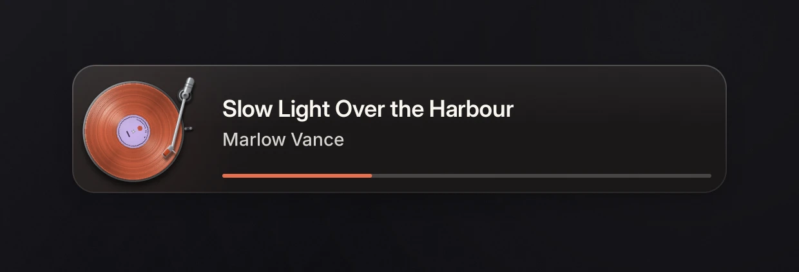

<p align="center">
  <picture>
    <source media="(prefers-color-scheme: dark)" srcset="docs/media/brand/wordmark-dark.svg">
    
  </picture>
</p>

<p align="center">
  A native now-playing overlay for OBS Studio on Windows.<br>
  It shows what you're listening to as a designed card, and can show the album's own motion artwork.
</p>

<p align="center">
  <a href="https://github.com/cxrlosxk/tonearm/releases/latest"></a>
  <a href="#requirements"></a>
  <a href="LICENSE"></a>
</p>

<p align="center">
  <a href="https://github.com/cxrlosxk/tonearm/releases/latest"><b>Download</b></a> &nbsp;·&nbsp;
  <a href="#install">Install</a> &nbsp;·&nbsp;
  <a href="#animated-album-artwork">Animated artwork</a> &nbsp;·&nbsp;
  <a href="#four-presets">Presets</a> &nbsp;·&nbsp;
  <a href="docs/settings.md">Settings</a> &nbsp;·&nbsp;
  <a href="docs/troubleshooting.md">Help</a>
</p>

<br>

<p align="center">
  
</p>

Tonearm reads the track Windows already knows about, from Apple Music, Spotify and any other player in the volume flyout, and draws it inside OBS as a real source: title, artist, album, artwork and a progress bar that moves smoothly between the player's updates. There is no browser source, no account and no API key.

## Animated album artwork

<p align="center">
  <a href="docs/media/artwork/artwork.mp4"></a>
</p>

Many albums on Apple Music have a moving cover. With **Animated artwork** turned on, Tonearm finds that video for the album you're playing and plays it in place of the still cover, masked into whichever preset and layout you use. The clip above is a screen recording of Tonearm 0.2.0 running in OBS Studio on Windows 11 with Apple Music; nothing in it was edited apart from cropping. ([MP4](docs/media/artwork/artwork.mp4), [GIF](docs/media/artwork/artwork.gif))

- **Off by default and opt-in.** Track metadata always comes from Windows on your PC. Only when you turn this on does Tonearm send the artist and album name to an independent artwork lookup service to find the video.
- **Cached on your PC.** Each video is downloaded once to `%LOCALAPPDATA%\Tonearm\MotionCache`. Playing the album again starts instantly and needs no lookup.
- **Light on the GPU.** *Smart* quality picks a resolution that matches the card's size on screen, instead of decoding 4K for a small overlay.
- **Always a cover.** When an album has no motion artwork, or the lookup fails, the still cover stays exactly as before.

You can also skip the online lookup and point Tonearm at a folder of your own videos. [Animated artwork](docs/animated-artwork.md) explains matching, quality, the cache and privacy.



## Five presets

<p align="center">
  
</p>

The presets differ in more than color. **Glass** builds a frosted surface from a blurred copy of the artwork. **Minimal** is flat and quiet and shows only the remaining time. **Neon** is dark glass with a glowing edge and progress line. **Editorial** sets the title in a serif over full-bleed artwork. **Turntable** puts the album sleeve behind a spinning record, with a tonearm that lifts on pause and tracks inward through the song. The record's color and label come from the cover. Each has its own type, surface and transitions.

<p align="center">
  
</p>

<details>
<summary>All twenty preset and layout combinations</summary>
<br>



 

</details>

## Four layouts

<p align="center">
  
</p>

Compact and expanded bars, a square card and a tall vertical card. Each layout rearranges its content for the size you give it, and everything is drawn at the source's real size, so a bigger source is sharper rather than stretched.

## What else it does

- **Finds your music automatically.** Anything that shows up in the Windows media flyout works. Apple Music, Spotify, TIDAL, Deezer, Amazon Music, foobar2000, MusicBee, VLC and Media Player are recognised by name.
- **Picks the right player.** Automatic, a preferred order, or a strict allow list. Browsers are left out unless you include them, because they also report videos and ads.
- **Colors from the artwork, kept readable.** Accent and tint come from the cover, and text is checked against the real background to meet WCAG AA contrast.
- **Smooth progress.** Players report their position only now and then, so Tonearm counts forward between reports and glides across seeks.
- **Considered motion.** Track changes, late-arriving artwork, pause and resume each have their own transition. Long titles scroll with soft edges. *Reduce motion* swaps everything for short crossfades and keeps the still cover.
- **Handles silence.** Paused (dim, keep or hide after a delay), nothing playing (hide or show a message) and player closed are all covered.
- **Presets as files.** Export your settings to JSON and import them into another scene or PC.
- **Cheap to run.** Text and surfaces are drawn on a background thread only when something changes; each frame the GPU composites a few textures. A source that isn't visible in any scene does no work at all.

## Install

1. Download `tonearm-v0.3.0-windows-x64.zip` from the [latest release](https://github.com/cxrlosxk/tonearm/releases/latest).
2. Close OBS completely, including from the system tray.
3. Extract the zip into your OBS folder, usually `C:\Program Files\obs-studio`. It contains an `obs-plugins` and a `data` folder that **merge** into the ones already there; if Windows asks, choose to merge, never to replace.
4. Start OBS, click **+** under Sources and add **Tonearm Now Playing**.

You'll end up with `obs-plugins\64bit\tonearm.dll` and `data\obs-plugins\tonearm\`. To uninstall, delete those two. [Getting started](docs/getting-started.md) covers the details, the alternative `C:\ProgramData` location, and first-time setup. The separate `-pdb` zip holds debug symbols and is only needed for crash reports.

## Requirements

| | |
|---|---|
| Windows | Windows 10 version 1809 or newer, or Windows 11, 64-bit |
| OBS Studio | 30.2 or newer, 64-bit |
| Players | Anything in the Windows media flyout |
| Animated artwork | Optional. Needs an internet connection the first time each album is played |
| Linux, macOS | Builds and runs with sample tracks only; there is no media connection yet |

## Privacy

Without animated artwork, Tonearm makes no network requests: everything it shows comes from Windows on your PC. With the online animated artwork turned on, it sends the current artist and album name to the third-party lookup service [artwork.m8tec.top](https://artwork.m8tec.top), may ask Apple's public iTunes Search API about the same album to confirm the right edition, and downloads the video from Apple's CDN. Albums already in the cache need no requests at all. It never sends your Apple ID, credentials or listening history. Setting a local artwork folder turns the online lookup off entirely.

## Limitations

- **The motion artwork lookup is unofficial.** It relies on an independent service that isn't run by Apple or by Tonearm. It can change or go away, and not every album has motion artwork.
- **No audio visualizer.** Windows media controls carry metadata, not audio, and a visualizer that moved without real audio would be pretending.
- **Position is extrapolated** between the player's reports and is accurate to about a second.
- **Artwork resolution is up to the player.** Some players hand Windows a small thumbnail, which looks soft on large layouts.
- **No playback controls.** Tonearm shows what's playing; it doesn't play, pause or skip.
- **Live data on Windows only** for now.

More in [Troubleshooting](docs/troubleshooting.md).

## Documentation

[Getting started](docs/getting-started.md) · [Settings reference](docs/settings.md) · [Animated artwork](docs/animated-artwork.md) · [Troubleshooting](docs/troubleshooting.md) · [Architecture](docs/architecture.md) · [Building](docs/building.md) · [Testing](docs/testing.md) · [Changelog](CHANGELOG.md) · [Media design](docs/media/DESIGN.md)

## Building from source

```sh
cmake -S . -B build -DTONEARM_BUILD_TESTS=ON
cmake --build build --config RelWithDebInfo
ctest --test-dir build -C RelWithDebInfo
```

Windows needs Visual Studio 2022, the Windows SDK and a libobs SDK; Linux needs `libobs-dev` and `libpango1.0-dev`. See [Building](docs/building.md). Every image on this page except the animated-artwork recording is rendered by Tonearm's own scene and rasterizer code with the tools in [`tools/`](tools/media).

## License and credits

Tonearm is free software under the GNU General Public License, version 2 or any later version. See [LICENSE](LICENSE).

It bundles Inter, IBM Plex Sans, IBM Plex Mono and EB Garamond under the SIL Open Font License 1.1 ([NOTICE.md](NOTICE.md)). Thanks to lingeriegoat for [OBSSpotifyPlugin](https://github.com/lingeriegoat/OBSSpotifyPlugin), which showed that a native SMTC overlay for OBS was worth doing well, and to [CoverPy](https://github.com/matteing/coverpy) for documenting how Apple Music motion artwork is structured.

The album artwork shown in the animated-artwork recording belongs to the artists and their labels and is shown only to demonstrate the feature; see [NOTICE.md](NOTICE.md#media-in-this-repository). The sample tracks in every other image are invented. Apple Music, Spotify and other product names belong to their owners. Tonearm is not affiliated with or endorsed by any of them, or by the OBS Project.
