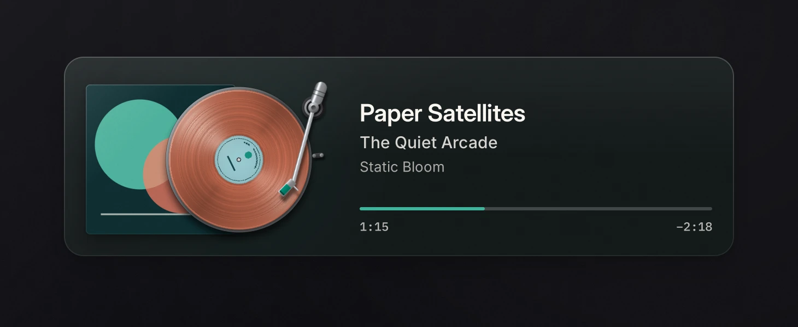
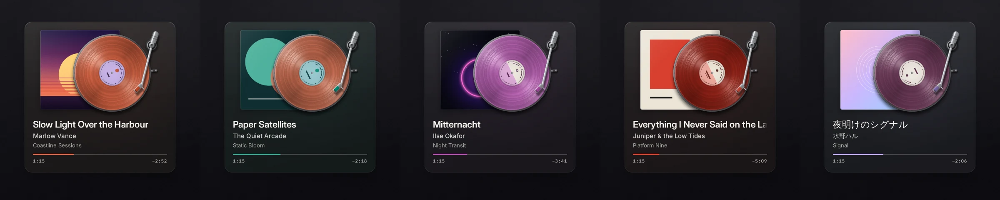

Tonearm 0.3.0 adds a fifth preset, **Turntable**: a vinyl deck that plays along with your music.

  

## Download

- **`tonearm-v0.3.0-windows-x64.zip`** is the plugin. Close OBS, extract the zip into your OBS folder (usually `C:\Program Files\obs-studio`) and let Windows **merge** the `obs-plugins` and `data` folders. Installing over 0.2.0 is fine. Then pick **Turntable** under Preset in a Tonearm source.
- `tonearm-v0.3.0-windows-x64-pdb.zip` holds debug symbols. You only need it when reporting a crash.

Requires Windows 10 1809 or newer (64-bit) and OBS Studio 30.2 or newer. Full steps are in [Getting started](https://github.com/vatariii/tonearm/blob/main/docs/getting-started.md).

## Turntable

- **The record** has real grooves, track gaps and a lip, and turns under a fixed light. Its color comes from the cover but stays distinct from the sleeve. Monochrome covers get classic black vinyl.
- **Labels** are designed per album: one of five understated styles, colored from the cover and shared by every track on that album.
- **The tonearm** sets down on the lead-in, tracks inward with the song, and lifts to its rest on pause and between tracks. The platter spins up to 33⅓ RPM and coasts to a stop.
- **Animated artwork** plays on the sleeve behind the record, never on the vinyl.
- **All four layouts** have their own composition. Compact is just the record and its arm. Square and Vertical give the deck most of the card.
- Reduce motion stops the spin and the arm. The other four presets look exactly as they did in 0.2.0.

  

The album covers in these images belong to their artists and labels.

The full list of changes is in the [changelog](https://github.com/vatariii/tonearm/blob/main/CHANGELOG.md).

Created by [Carlos](https://carlosk.me) · A Vatari project
